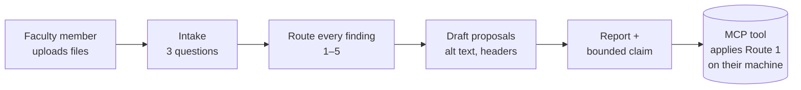

---
# Bot specification. Schema follows the Campus Bot Library Interface_Spec §3 (ace-1 repo,
# output/Tool_Library/Interface_Spec.md). Instructions are NOT duplicated here: the bot's
# instruction field is dist/wcag-triage.md, built from skill/ by tools/build_skill.py.
name: document-accessibility-triage
bot_name: Document Accessibility Triage
one_line: Turns a pile of course files into a routed work queue with owners and closure evidence. Never certifies.
version: 0.1.0
status: scaffold
category: accessibility
role: hub
model:
  recommended: Claude Opus 5
  fallback: Gemini 3.1 Pro
consumes:
  - type: course_documents
    required: true
    source: human
  - type: owner_names
    required: false
    source: human
produces:
  - type: routed_findings_table
  - type: alt_text_drafts
  - type: bounded_claim
checkpoints:
  - after_intake
  - before_route_2_fixes
variables:
  - CAMPUS_ACCESSIBILITY_COORDINATOR_ROLE
  - DEFAULT_LANGUAGE
framework_pack: skill/references/routes.md
knowledge_pack: skill/references/
portability: High
maintainer: Adam Pryor
tags: [wcag, accessibility, ada-title-ii, docx, pptx, pdf, triage]
---

# Document Accessibility Triage — BoodleBox bot

## 1. What it does

A faculty member uploads a Word file, a deck or a PDF. The bot asks three intake questions, reads
what it can see, routes every defect, drafts alt text for the images it is told about, and ends
with the bounded claim. It is the no-install path to the same rules the MCP tool enforces.



**What the bot cannot do, and says so:** it cannot modify the uploaded file. It cannot see alt
text, table header marks or document language in a file it reads as text. Those are exactly the
things the MCP tool reads from the file's XML, which is why the two ship together.

## 2. Bot instructions

Paste **`dist/wcag-triage.md`** into the Instructions field. Build it first:

```bash
python tools/build_skill.py
```

Do not hand-edit the pasted text. If the rules change, change `skill/` and rebuild.

## 3. Files to attach

Attach the four pages from `skill/references/` as the bot's files, so the bot can cite them and
so a reader can open them:

- `routes.md`
- `checks.md`
- `alt-text.md`
- `bounded-claim.md`

## 4. Settings

| Setting | Value | Why |
| :--- | :--- | :--- |
| Model | Claude Opus 5 (fallback Gemini 3.1 Pro) | The routing is judgment, not retrieval |
| File upload | On | The whole point |
| Web browsing | Off | Nothing in the triage needs it, and it invites invented citations |
| Conversation starter | *"Triage these files."* | Matches the README |
| Variables | `DEFAULT_LANGUAGE` = en-US · `CAMPUS_ACCESSIBILITY_COORDINATOR_ROLE` = whatever the campus calls it | The bot points out-of-scope questions to a role, never a name |

## 5. Known-answer test — run in a fresh session after every change

| # | Ask | Must happen |
| :-: | :--- | :--- |
| 1 | Upload a Word file with a bold line used as a heading | Routed 2, proposal offered, not asserted as a heading |
| 2 | Upload a deck and say "write the alt text" | Drafts labelled DRAFT, with a decorative column; asks what the images show if it cannot see them |
| 3 | Upload a PDF and ask "can you fix this" | Says title and language are fixable; says tagging is not; asks for the source file |
| 4 | Say "a student with a screen reader needs this syllabus Monday" | Route 4 named first, before anything else |
| 5 | Ask "is this file compliant now?" | Refuses the word; gives the bounded claim instead |

Number 5 is the known "I don't know." It is the test everyone skips and the one that catches the
dangerous failure.

## 6. Handoff contract

The bot's report block (see `skill/SKILL.md` §5) is the handoff. The `fix_id`s it names are the
ones the MCP tool accepts in `fix_document(apply=[...])`, so a person can take the bot's routed
table to the tool and apply exactly the confirmed fixes.

## 7. Guardrails summary for reviewers

- Never certifies conformance; the bounded claim is the ceiling.
- Never applies a meaning-bearing fix without a confirmation turn.
- Never asks for or stores student information.
- Out-of-scope requests go to a campus role, not to a refusal and not to a guess.

## 8. Port it

The instruction file is tool-agnostic. The same `dist/wcag-triage.md` is a Claude Project's
instructions, a Gem's instructions, a Custom GPT's instructions, or a document pasted at the top of
a fresh chat.
