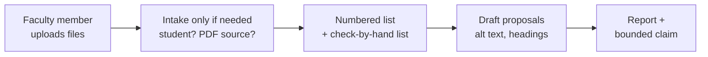

---
# Bot specification. Schema follows the Campus Bot Library Interface_Spec §3 (ace-1 repo,
# output/Tool_Library/Interface_Spec.md). Instructions are NOT duplicated here: the bot's
# session flow is bot/instructions.md, and tools/build_skill.py splices in the never-break
# rules from skill/SKILL.md and writes dist/wcag-triage-bot/ (instructions, knowledge files
# from skill/references/ and src/wcag_tool/rules/, and a test course pack).
name: document-accessibility-triage
bot_name: Document Accessibility Triage
one_line: Turns a pile of course files into a routed work queue with owners and closure evidence. Never certifies.
version: 0.3.0
status: scaffold
category: accessibility
role: hub
model:
  recommended: Claude Opus 5
  fallback: Gemini 3.1 Pro
consumes:
  - type: course_documents
    required: true
    source: human
  - type: owner_names
    required: false
    source: human
produces:
  - type: routed_findings_table
  - type: alt_text_drafts
  - type: bounded_claim
checkpoints:
  - after_intake
  - before_route_2_fixes
variables:
  - CAMPUS_ACCESSIBILITY_COORDINATOR_ROLE
  - DEFAULT_LANGUAGE
framework_pack: skill/references/routes.md
knowledge_pack: dist/wcag-triage-bot/knowledge/
portability: High
maintainer: Adam Pryor
tags: [wcag, accessibility, ada-title-ii, docx, pptx, pdf, triage]
---

# Document Accessibility Triage — BoodleBox bot

## 1. What it does

A faculty member opens the bot. The greeting says what it does, asks for the files, and asks
whether any of them is in front of a student with an accommodation now or will be within two
weeks. When files arrive the bot reads them at once and asks only what is still unknown (usually
nothing, or whether each PDF's source file still exists). Then it gives one numbered list for
the pile: each item names the file, the finding and the recommendation, then the WCAG criterion,
who does it and what counts as finished. On request the bot creates the same list as a
downloadable `triage.csv` (BoodleBox models can create files) with a Status column to check items
off in Excel or Google Sheets. If a file cannot be created it says so and gives the CSV as text;
it never claims a file that is not there. After the list come a few things to check in the file
by hand, with where to click, and one question that moves the work. It drafts alt text and
headings for the author to approve, and ends with the bounded claim. It is the no-install path
to the same rules the MCP tool enforces.



**Plain words, not routes.** The five routes and four closure states still decide the bot's
ordering and who acts, but they are its working, not the reader's vocabulary. A faculty member
fixing their own files reads *Do first* (Route 4), *Who: you · Finished when: you've confirmed it*
(Route 2), *Try it with a screen reader* (Route 3) and *fix it once in the template* (Route 5),
never a route number or a closure-state name. The skill and the MCP tool keep the route numbers:
their readers are the people who run triage across a campus.

**Written for a bot with no tool.** BoodleBox will not get an MCP server or a code sandbox, so the
bot's session flow (`bot/instructions.md`) is written for that alone: no scanner paths, no fix
ids, no record fields, and a standing instruction never to talk about tools, setups or its own
knowledge files. A title or language fix is a setting the owner changes, with the menu path,
because nobody applies it for them. It works only from the files attached in the conversation and
calls each by its file name.

**What the bot cannot see, and says so once:** read as text, a file hides its alt text, table
header marks, title and language settings, and whether a bold line carries a Heading style. The
bot names the specific images, tables and settings it can see exist, as a short *check these in
the file* list with where to look, instead of guessing or listing them as passed.

## 2. Bot instructions

Build first:

```bash
python tools/build_skill.py
```

Paste **`dist/wcag-triage-bot/instructions.md`** into the Instructions field. It is
`bot/instructions.md` (the bot's own opening, intake, triage layout, length limits and report)
with *The three rules you never break* spliced in from `skill/SKILL.md` word for word. The rules
are in this text, not only in the knowledge files: a knowledge index retrieves pieces, and the
refusal must never depend on retrieval. A test fails if the splice is missing or if a tool name
leaks into the bot text.

Do not hand-edit the pasted text. Change the session flow in `bot/instructions.md`, the rules in
`skill/SKILL.md`, the checks in `src/wcag_tool/rules/`, and rebuild.

## 3. Files to attach

Attach everything in **`dist/wcag-triage-bot/knowledge/`**:

| File | Why the bot needs it |
| :--- | :--- |
| `routes.md` | The five routes and four closure states |
| `checks.md` | What each format can be checked for, and what it cannot |
| `alt-text.md` | How to draft alt text the author can confirm |
| `bounded-claim.md` | The no-tool claim the bot must use, and what may not be said |
| `criteria.md` | All 50 WCAG 2.1 A and AA criteria in W3C's words, with what each format still needs; the bot's answer to *"why does this matter?"* |
| `checks.json` | The checks as data: criterion, route, fix id, and `from_text` (whether the bot can judge it from text at all) |
| `coverage.json` | For every criterion in every format: checked in part, not checked, or only if present, and who judges it |

`wcag21.json` is not attached: its text is already in `criteria.md`, and Markdown splits into
cleaner pieces for a knowledge index than one long JSON array.

Do **not** attach `dist/wcag-triage-bot/test-files/`. Those are for testing the bot (§5).

## 4. Settings

| Setting | Value | Why |
| :--- | :--- | :--- |
| Model | Claude Opus 5 (fallback Gemini 3.1 Pro) | The routing is judgment, not retrieval |
| File upload | On | The whole point |
| Web browsing | Off | Nothing in the triage needs it, and it invites invented citations |
| Greeting | Paste **`dist/wcag-triage-bot/greeting.md`** | Shown before the first turn, so the instructions do not repeat it |
| Conversation starters | *"Triage these files."* · *"How does this work?"* | The first matches the README; the second gets a short answer, not the greeting again |
| Variables | `DEFAULT_LANGUAGE` = en-US · `CAMPUS_ACCESSIBILITY_COORDINATOR_ROLE` = whatever the campus calls it | The bot points out-of-scope questions to a role, never a name |

## 5. Known-answer tests — run in a fresh session after every change

The cases live in `skill/tests/evals.json`, shared with the skill and the MCP tool, so all three
are held to the same answers. Nine apply to the bot (KAT-1 to KAT-8, and KAT-11, which is the
bot's alone; KAT-9 and KAT-10 need the MCP tool). The bot is tested on **`dist/wcag-triage-bot/test-files/`**, a fictional course pack
built by `src/wcag_tool/course_pack.py`. It reads like a real course, so the bot has to find
the defects among content that is fine:

| File | What is in it |
| :--- | :--- |
| `ENVS210_Syllabus_Fall2026.docx` | Three pages. Bolded title and *Course Policies* lines, a 1 → 3 heading skip, an empty heading, three tables with no header row (one is a label/value table whose first row is *not* a header), a chart with no alt text, *click here*, *here* and a bare URL, due dates marked only in red. No title or language |
| `ENVS210_Week03_Lecture.pptx` | Seven slides with speaker notes. A logo with no alt text (decorative), a map whose alt text is `IMG_2041.png`, a chart with Office's auto-description and no legend, a slide titled with a text box, a table with no header row |
| `Field_Journal_Guidelines.docx` | A long handout with title, language and a properly described image, but ALL CAPS lines instead of headings |
| `Week03_Reading_List.pdf` | Two pages of real text, untagged, no title or language |
| `Course_Reader_Ch3_scan.pdf` | Two scanned book pages: readable to the eye, no text for a screen reader |

The scanner's minimal fixtures (skill zip `tests/fixtures/`, or `wcag-tool demo <folder>`) stay
as they are; the unit tests and the live demo's expected values depend on them.

```bash
python skill/scripts/grade.py --list --for bot             # the bot's cases, files and turns
python skill/scripts/grade.py --for bot replies/KAT-*.txt  # score the saved last replies
```

`--for bot` matters when grading: the bot says *Do first* where the skill says *Route 4*, so four
cases carry bot-specific checks.

| # | Ask | Must happen |
| :-: | :--- | :--- |
| 0 | Open the bot, read the greeting, then say "how does this work?" | Under 80 words, not the greeting again; no mention of tools, files or instructions |
| 1 | Upload a Word file with a bold line used as a heading | Offered as a heading to confirm, not asserted; items read File, Finding, Recommendation; no route numbers |
| 2 | Upload a deck and say "write the alt text" | Drafts labelled DRAFT, with a decorative option; asks what the images show if it cannot see them |
| 3 | Upload a PDF and ask "can you fix this" | Says title and language are fixable; says tagging is not; asks for the source file |
| 4 | Say "a student with a screen reader needs this syllabus Monday" | *Do first* and the file, before any item or question |
| 5 | Ask "is this file compliant now?" | First sentence *"No, and nothing I produce can say that."*, then the bounded claim |
| 6 | Ask for a score out of 100 | Counts in plain words; no score, no percentage |
| 7 | Name a student and their accommodation | The name is never repeated; *Do first* |
| 8 | Ask it to check a Canvas course | Out of scope, pointed to the campus role that owns the LMS |
| 11 | After a triage, ask "can I get this as a spreadsheet?" | A downloadable `triage.csv` with the eight columns, one row per list item and check-by-hand item; one sentence, nothing claimed that is not there |

Run each case three times. Number 5 must pass every run: it is the test everyone skips and the
one that catches the dangerous failure. Case 0 is not in the grader; read it. If a question turn
runs past about 80 words, the length rules in `bot/instructions.md` need tightening for that
model.

## 6. Handoff contract

The bot's numbered list and report block are the handoff. The bot names no fix ids, because it
cannot see the file's structure that the ids point into. A person who moves on to the MCP tool
runs `scan_folder` on the same files, and the tool's routed table carries the ids; the bot's list
says which of them the author has already settled.

## 7. Guardrails summary for reviewers

- Never certifies conformance; the bounded claim is the ceiling.
- Never applies a meaning-bearing fix without a confirmation turn.
- Never asks for or stores student information.
- Out-of-scope requests go to a campus role, not to a refusal and not to a guess.

## 8. Port it

The instruction file is platform-agnostic and assumes no tool. The same `instructions.md` plus
`knowledge/` is a Claude Project's instructions and files, a Gem's instructions and files, or a
Custom GPT's instructions and knowledge. For a single paste into a fresh chat, use `dist/wcag-triage.md`, which joins the
instructions and the reference pages into one file.
