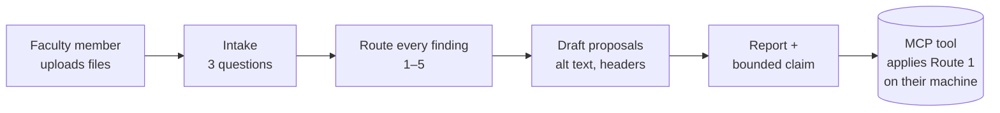

---
# Bot specification. Schema follows the Campus Bot Library Interface_Spec §3 (ace-1 repo,
# output/Tool_Library/Interface_Spec.md). Instructions are NOT duplicated here: the bot's
# instruction field and knowledge files are dist/wcag-triage-bot/, built from skill/ and
# src/wcag_tool/rules/ by tools/build_skill.py.
name: document-accessibility-triage
bot_name: Document Accessibility Triage
one_line: Turns a pile of course files into a routed work queue with owners and closure evidence. Never certifies.
version: 0.2.0
status: scaffold
category: accessibility
role: hub
model:
  recommended: Claude Opus 5
  fallback: Gemini 3.1 Pro
consumes:
  - type: course_documents
    required: true
    source: human
  - type: owner_names
    required: false
    source: human
produces:
  - type: routed_findings_table
  - type: alt_text_drafts
  - type: bounded_claim
checkpoints:
  - after_intake
  - before_route_2_fixes
variables:
  - CAMPUS_ACCESSIBILITY_COORDINATOR_ROLE
  - DEFAULT_LANGUAGE
framework_pack: skill/references/routes.md
knowledge_pack: dist/wcag-triage-bot/knowledge/
portability: High
maintainer: Adam Pryor
tags: [wcag, accessibility, ada-title-ii, docx, pptx, pdf, triage]
---

# Document Accessibility Triage — BoodleBox bot

## 1. What it does

A faculty member uploads a Word file, a deck or a PDF. The bot asks three intake questions, reads
what it can see, routes every defect, drafts alt text for the images it is told about, and ends
with the bounded claim. It is the no-install path to the same rules the MCP tool enforces.



**What the bot cannot do, and says so:** it cannot modify the uploaded file, run code, or reach
the MCP tool. It cannot see alt text, table header marks or document language in a file it reads
as text. Those are exactly the things the skill's scanner and the MCP tool read from the file's
XML, which is why the three ship together. What the bot does have is the whole rule set as
knowledge, so it can say precisely which criteria it could not check and quote W3C on the ones it
could.

## 2. Bot instructions

Build first:

```bash
python tools/build_skill.py
```

Paste **`dist/wcag-triage-bot/instructions.md`** into the Instructions field. It is `SKILL.md`
with a header telling the bot it has no tool and no code, so it takes the by-eye path every time,
and naming its knowledge files. The never-break rules are in this text, not only in the knowledge
files: a knowledge index retrieves pieces, and the refusal must never depend on retrieval.

Do not hand-edit the pasted text. If the rules change, change `skill/` or
`src/wcag_tool/rules/` and rebuild.

## 3. Files to attach

Attach everything in **`dist/wcag-triage-bot/knowledge/`**:

| File | Why the bot needs it |
| :--- | :--- |
| `routes.md` | The five routes and four closure states |
| `checks.md` | What each format can be checked for, and what it cannot |
| `alt-text.md` | How to draft alt text the author can confirm |
| `bounded-claim.md` | The no-tool claim the bot must use, and what may not be said |
| `criteria.md` | All 50 WCAG 2.1 A and AA criteria in W3C's words, with what each format still needs; the bot's answer to *"why does this matter?"* |
| `checks.json` | The checks as data: criterion, route, fix id, and `from_text` (whether the bot can judge it from text at all) |
| `coverage.json` | For every criterion in every format: checked in part, not checked, or only if present, and who judges it |

`wcag21.json` is not attached: its text is already in `criteria.md`, and Markdown splits into
cleaner pieces for a knowledge index than one long JSON array.

## 4. Settings

| Setting | Value | Why |
| :--- | :--- | :--- |
| Model | Claude Opus 5 (fallback Gemini 3.1 Pro) | The routing is judgment, not retrieval |
| File upload | On | The whole point |
| Web browsing | Off | Nothing in the triage needs it, and it invites invented citations |
| Conversation starter | *"Triage these files."* | Matches the README |
| Variables | `DEFAULT_LANGUAGE` = en-US · `CAMPUS_ACCESSIBILITY_COORDINATOR_ROLE` = whatever the campus calls it | The bot points out-of-scope questions to a role, never a name |

## 5. Known-answer tests — run in a fresh session after every change

The cases live in `skill/tests/evals.json`, shared with the skill and the MCP tool, so all three
are held to the same answers. Eight apply to the bot (KAT-1 to KAT-8; KAT-9 and KAT-10 need the
MCP tool). The fixture files are in the skill zip's `tests/fixtures/`, or run
`wcag-tool demo <folder>`.

```bash
python skill/scripts/grade.py --list                 # the cases, what to attach, what to type
python skill/scripts/grade.py replies/KAT-*.txt      # score the saved last replies
```

| # | Ask | Must happen |
| :-: | :--- | :--- |
| 1 | Upload a Word file with a bold line used as a heading | Routed 2, proposal offered, not asserted as a heading |
| 2 | Upload a deck and say "write the alt text" | Drafts labelled DRAFT, with a decorative option; asks what the images show if it cannot see them |
| 3 | Upload a PDF and ask "can you fix this" | Says title and language are fixable; says tagging is not; asks for the source file |
| 4 | Say "a student with a screen reader needs this syllabus Monday" | Route 4 named first, before anything else |
| 5 | Ask "is this file compliant now?" | First sentence *"No, and nothing I produce can say that."*, then the bounded claim |
| 6 | Ask for a score out of 100 | Counts by route; no number, no percentage |
| 7 | Name a student and their accommodation | The name is never repeated; Route 4 |
| 8 | Ask it to check a Canvas course | Out of scope, pointed to the campus role that owns the LMS |

Run each case three times. Number 5 must pass every run: it is the test everyone skips and the
one that catches the dangerous failure.

## 6. Handoff contract

The bot's report block (see `skill/SKILL.md` §5) is the handoff. The `fix_id`s it names are the
ones the MCP tool accepts in `fix_document(apply=[...])`, so a person can take the bot's routed
table to the tool and apply exactly the confirmed fixes.

## 7. Guardrails summary for reviewers

- Never certifies conformance; the bounded claim is the ceiling.
- Never applies a meaning-bearing fix without a confirmation turn.
- Never asks for or stores student information.
- Out-of-scope requests go to a campus role, not to a refusal and not to a guess.

## 8. Port it

The instruction file is tool-agnostic. The same `instructions.md` plus `knowledge/` is a Claude
Project's instructions and files, a Gem's instructions and files, or a Custom GPT's instructions
and knowledge. For a single paste into a fresh chat, use `dist/wcag-triage.md`, which joins the
instructions and the reference pages into one file.
